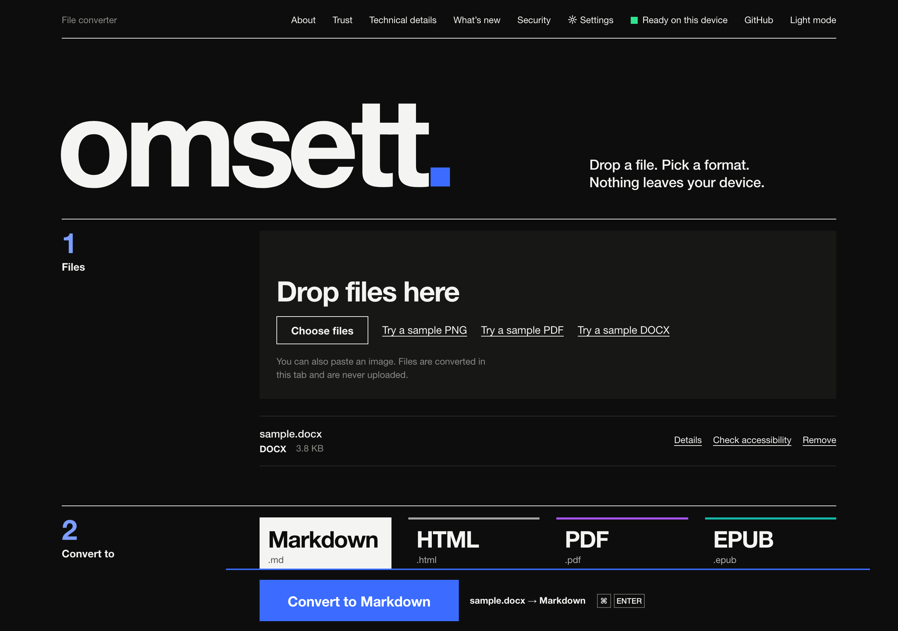
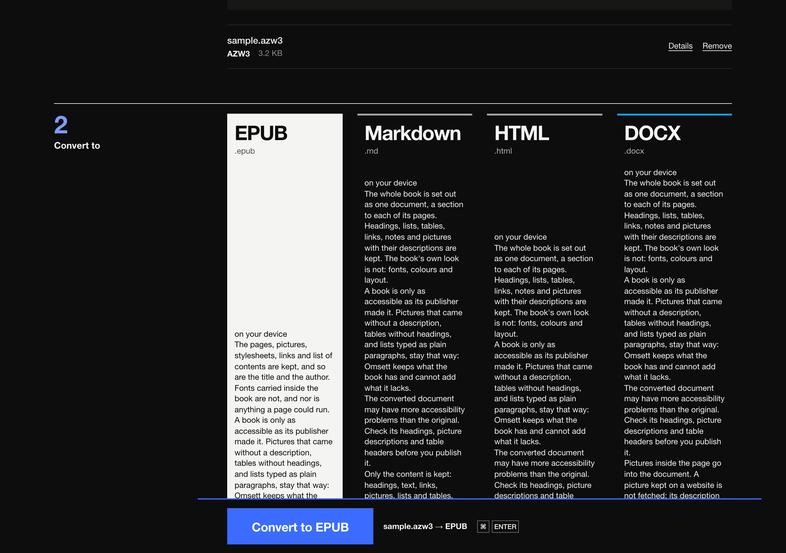
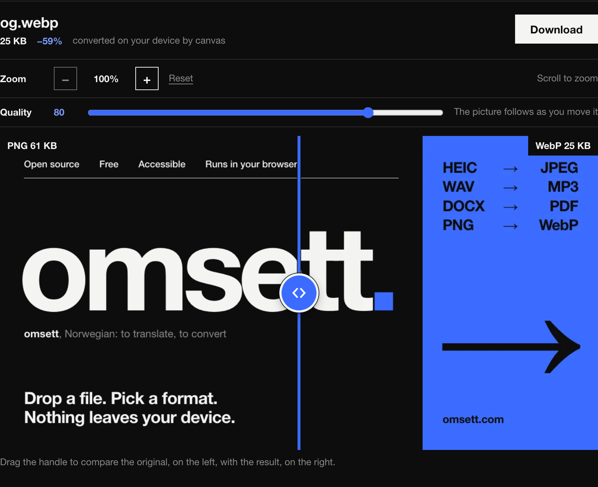
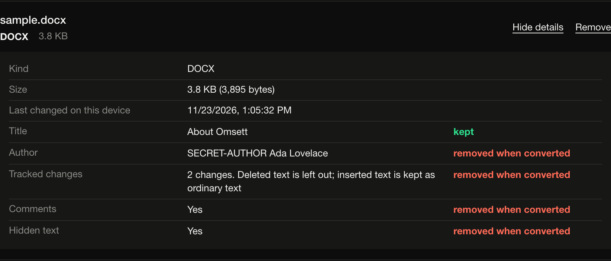
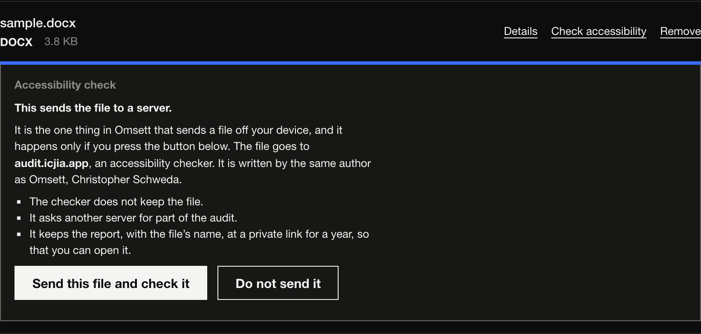
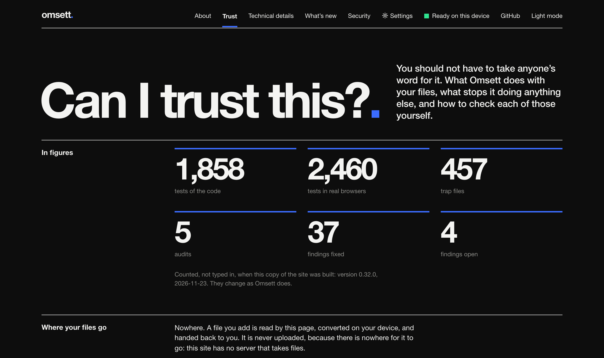

<p align="center">
  
</p>

<p align="center">
  <a href="https://forge.laravel.com/chris-schweda/aged-autumn-jm7/3514825"></a>
  <a href="https://github.com/cschweda/omsett/actions/workflows/ci.yml"></a>
  <a href="https://omsett.com"></a>
  <a href="LICENSE"></a>
  <a href="CHANGELOG.md"></a>
</p>

# Omsett

**Drop a file. Pick a format. Nothing leaves your device.**

Omsett is a free, open-source file converter. Every conversion runs in your browser, on your own device, so your files are never uploaded: there is no server for them to go to. Pictures, documents, spreadsheets, data, subtitles, screenplays, fonts, archives, sound (MP3, WAV, FLAC, AIFF) and e-books (EPUB and Kindle) convert today; more sound formats, video and a desktop app are ahead.

*Omsett* is Norwegian: to translate; to convert.

> **Live at [omsett.com](https://omsett.com).** The site's own [About](https://omsett.com/about), [Trust](https://omsett.com/trust), [Technical details](https://omsett.com/technical) and [What's new](https://omsett.com/whats-new) pages are generated from the code and are always current.

<p align="center">
  
</p>

## What it does today

<!-- facts:start -->
<!-- Generated from the registry by `pnpm readme:facts`. Do not edit by hand. -->

**78 formats, 329 conversions**, every one of them run in your browser, on your device, and tested against 788 files made on purpose to be broken, hostile or dishonest. How many tests there are today is on the site's [Trust](https://omsett.com/trust) page, counted at every build.

| Kind | Converts to and from | Reads only |
| --- | --- | --- |
| Pictures | WebP, JPEG, PNG, AVIF, GIF, TIFF, JPEG XL, BMP, TGA, QOI, Netpbm, ICO, ICNS, CUR, JPEG 2000, DDS | HEIC, Animated PNG, PSD, PSB, OpenEXR, Radiance HDR, FITS, DICOM, DNG, PCX, SGI, Sun Raster |
| Drawings | — | SVG, SVGZ |
| Documents | DOCX | DOC, ODT |
| Presentations | — | PPTX, PPT, ODP |
| PDF | PDF | — |
| Text and markup | Markdown, HTML | — |
| Spreadsheets | XLSX | XLS, ODS |
| Data | JSON, YAML, CSV, XML, TOML, JSON Lines, TSV, vCard, iCalendar | — |
| Subtitles | SRT, WebVTT, ASS, SSA, TTML, LRC, SBV, SAMI, MicroDVD | — |
| Screenplays | Fountain, Final Draft, Drafter | — |
| Fonts | WOFF2, WOFF, TTF, OTF | — |
| Sound | MP3, WAV, FLAC, AIFF, AU | — |
| E-books | EPUB | AZW3, MOBI |
| Archives | ZIP, TAR.GZ, TAR | — |

A file is offered the formats of its own kind: a picture becomes another picture, a workbook becomes data, a Word document becomes a web page or Markdown.

<!-- facts:end -->

- **Says what a conversion will lose before you start it**: transparency, animation, layers, formatting. And what it removes on purpose: author names, locations, and other metadata.
- **Shows what a file holds besides what it shows** (who wrote it, when, where a photo was taken, tracked changes, hidden text), and whether converting keeps or removes each.
- **Goes by what a file contains, not what it is called.** A JPEG named `.png` is converted as a JPEG.
- **Refuses a damaged or hostile file with a reason**, instead of returning half of one or freezing the tab. Every conversion runs against a clock.
- **Writes PDF, tagged for screen readers**: a Word document, a web page or Markdown becomes a PDF whose headings, lists, tables and picture descriptions are marked as what they are. In Latin, Greek, Cyrillic, Chinese, Japanese, Korean, Arabic, Hebrew, Hindi and Thai. And reads PDF back to a web page, Markdown or DOCX.
- **Never carries across what an author hid or deleted**: tracked deletions, hidden text and slides, comments, speaker notes.
- **Names what it makes so it is not mistaken for the original**: “report-converted.pdf”, or words of your own, set in Settings.
- **Reads e-books**: an EPUB or a Kindle book (AZW3 or MOBI, without copy protection) becomes a PDF, a Word document, Markdown or a web page, with its headings, notes, links and pictures kept; a Kindle book also becomes an EPUB, read on anything.
- **Makes an EPUB of a document**: Word, Markdown, a web page or a PDF, a chapter to each main heading, the headings as its list of contents.

<p align="center">
  
</p>

- **Makes a PDF, a Word document or a web page of a spreadsheet**: a workbook or a CSV is set out as a real table, with its column names marked, on pages turned sideways if it is wide.
- **Makes a PDF of a picture**: a scan or a photograph becomes a page, without the photograph's location and other metadata.
- **Makes icons**: any picture to a Windows icon, a Mac icon or a mouse pointer, at the sizes each expects.
- **Develops a raw photograph (DNG)** with standard settings, the right way up.
- **Converts a medical scan (DICOM) to a picture without the patient**: only the picture is read; the name, date of birth and notes never reach the converter.
- **Converts sound with nothing lost**: WAV, FLAC, AIFF and AU to one another, with not one number of the sound changed. A FLAC is checked against its own checksums as it is read, and one that does not match is refused.
- **Packs and unpacks MP3**, at a quality you choose, and refuses an MP3 with part of its sound missing, where a player would skip the gap and say nothing.
- **Says how long a recording runs** and how it is stored, before you start, and what title and artist a conversion leaves behind.
- **Try it without a file of your own**: a sample picture, PDF and Word document are in the drop zone.
- **See the result before you convert**: choose a picture and a format, and the original and what it will become are shown side by side, with a divider to drag and the quality to move. Nothing is fetched or saved to do it.
- **Before and after, side by side**, once converted too: a slider for pictures; the two texts for data and subtitles.
- **Opens OpenDocument presentations (.odp)** and makes them a web page, a Word document, Markdown or a PDF, a section to a slide. Speaker notes, hidden slides and hidden shapes are left behind.
- **Opens OpenDocument spreadsheets (.ods)** and makes them XLSX, CSV, JSON or any other data format, with numbers as numbers, dates as dates, and the value each formula last showed. Hidden sheets, comments and macros are left behind.
- **Opens OpenDocument text (.odt)**, as LibreOffice and many governments save it, and makes it DOCX, a web page, Markdown or a PDF. Deleted text, comments, notes and hidden sections are left behind.
- **Opens Office files saved with macros or as templates** (.docm, .dotx, .pptm, .ppsx, .xlsm and the rest) as the documents, presentations and workbooks they are. The macros are never run and never carried over.
- **Opens Word, Excel and PowerPoint files from before 2007 (.doc, .xls, .ppt)** and makes them DOCX, a web page, Markdown, PDF, XLSX, CSV or JSON, without running a macro or working out a formula. Speaker notes and hidden slides are left behind.
- **Choose which sheet of a workbook to convert**, by name, or all of them at once.
- **Convert to several formats at once**, and download everything as one ZIP.
- **Settings**: light or dark, your own words in the names of converted files, and whether your visit is counted.

<p align="center">
  
  
</p>

### Check a document's accessibility

On a copy of Omsett set up for it (omsett.com is), a PDF, Word, PowerPoint or Excel file can be scored for accessibility by [audit.icjia.app](https://audit.icjia.app), before converting and again on the converted file. This is the one thing that sends a file to a server, so it never happens by itself: pressing the button shows where the file would go and what is kept, and nothing is sent unless you then say so.

<p align="center">
  
</p>

### Can I trust this?

That is a page on the site: [omsett.com/trust](https://omsett.com/trust). It says where your files go and how to check that yourself, what a hostile file can and cannot do, how Omsett is tested, who has audited it and what is still open, and what it learns about you (that a page was opened; no cookies; you can turn it off).

<p align="center">
  
</p>

## Accessibility of the site itself

Every page was checked on 24 November 2026 with [axecap](https://github.com/ICJIA/axecap-mcp) 0.3.3 (axe-core 4.14.1) at WCAG level AA, at desktop and at phone width, in the dark theme: first version 0.44.0 as built, which had two faults, and then 0.44.1, which fixes them and has none. The pages: the converter, About, Trust, Technical details, What's new, Security, Settings, Trap files and Status.

| Finding | Rule | Where | WCAG | Status |
| --- | --- | --- | --- | --- |
| A table that scrolls sideways cannot be reached with the keyboard | `scrollable-region-focusable` | Technical details, the formats table, at phone width only | 2.1.1 Keyboard (level A, in WCAG 2.1) | Fixed in 0.44.1: every such table is a named region the keyboard can reach and scroll |
| Three links are smaller than 24 by 24 pixels: About, Trust and Trap files, in the footer | `target-size` | Every page, at both widths | 2.5.8 Target Size (level AA, new in WCAG 2.2; not part of 2.1) | Fixed in 0.44.1 |

Against WCAG 2.1 A and AA, that was one failure, on one page at one width; against WCAG 2.2 AA, one more, in the footer of every page. Checked again after the fixes, all nine pages pass every automated rule at both widths.

What this does not cover, so that the table is not read as more than it is:

- **An automated check finds a part of what can be wrong**, usually put at a third to a half. Nothing here was tested with a screen reader or by keyboard alone.
- **Pages were checked as they load.** The converter with a file added, a format chosen, a preview or a result on screen was not checked this way, nor was the light theme.
- The full audit of the interface, with NVDA and VoiceOver, is the last phase of the roadmap.

## Where it is going

| Public site (omsett.com) | Desktop app | CLI |
| --- | --- | --- |
| Everything the browser can do, via WebAssembly and WebCodecs: more sound formats and video next | The full suite, including video and office fidelity, with no server | `npx omsett report.docx --to pdf`: the same engines in Node |
| Purpose presets: OpenGraph image, favicon pack, responsive set | Watch folders, file associations, bundled ffmpeg | Batch, globs, `--watch`, JSON output for scripts |

A self-hostable image (Docker) serves the same site on your own network. There is no public server that takes files; there never will be.

## Principles

- **Private by construction.** Browser-tier conversions make no network request with file data. Verifiable in DevTools.
- **Accessible documents.** A converted document keeps what a screen reader relies on (headings, lists, table headers, picture descriptions, language), and says what to check. The interface's own WCAG 2.2 AA audit is the last phase of the roadmap.
- **Honest about limits.** Every target says where it runs and what it will lose before you click Convert.
- **The registry is data.** Adding a format is a record and a fixture, never a UI change.

## Stack

Nuxt 4 + Nuxt UI (a static site, served by nginx) · TypeScript · pnpm · Web Workers + WebAssembly (libvips, ImageMagick, libheif, resvg, pdf.js, Typst, mpg123, LAME) and Omsett's own readers and writers for data, documents, subtitles, screenplays, fonts, archives, sound and e-books · Docker for self-hosting. Every engine and its license is in [`THIRD-PARTY-NOTICES.md`](THIRD-PARTY-NOTICES.md).

## Run it locally

```
pnpm install
pnpm dev
open http://localhost:3000
```

To try it from a phone or another computer on the same network, use `pnpm dev:lan` and open `http://<this machine's address>:3000`. Over plain HTTP, browsers switch off what libvips needs, so Chrome and Firefox convert there and Safari cannot; `pnpm dev:lan:https` serves it over HTTPS with a self-signed certificate (accept the browser's warning once) and everything works.

Node 24 and pnpm (the versions in `.nvmrc` and `package.json`). `pnpm test` runs the unit and fixture tests; `pnpm build && pnpm e2e` runs the browser tests against the built site in Chromium, Firefox, and WebKit.

## Add a format

Formats are data. Nothing in the UI changes when one is added.

1. Add a `Format` record in [`packages/registry/src/formats/`](packages/registry/src/formats/) and list it in `formats/index.ts`. Write its `explain` paragraph for someone who has never heard of the format.
2. Add its id to the `reads` or `writes` of an engine in [`packages/registry/src/capabilities.ts`](packages/registry/src/capabilities.ts). Routes and fidelity warnings are derived from that.
3. Drop one small real file in `fixtures/<format-id>/`. The fixture tests pick it up and run it through every engine that claims the format, and a format that is bytes and not text is fuzzed from that file on every run.
4. Add its trap files, a code trap among them, in `fixtures/_tools/make-traps.py`: files made on purpose to be broken, hostile or dishonest, each with what must happen to it. Then `pnpm readme:facts`.

A new engine also needs an implementation in [`packages/engines/src/`](packages/engines/src/) and an entry, with its license and source, in `info.ts` and [`THIRD-PARTY-NOTICES.md`](THIRD-PARTY-NOTICES.md).

## Deploy

The site is static files plus a set of response headers the build generates. Without the headers the page loads but nothing converts, so each host gets them in its own format.

**The live site (DigitalOcean, nginx).** [`docs/deploy-digitalocean.md`](docs/deploy-digitalocean.md) has the full steps for a Laravel Forge server. In short: nginx serves `live/public`, includes the generated `headers.nginx`, and the deploy script is `scripts/publish-static.sh`, which builds and then switches to the new build in one step. Every push to `main` deploys; there is no staging branch.

**Self-host with Docker.** `docker compose up --build` serves the same build from Caddy at `http://localhost:8080`, as a non-root user on a read-only filesystem. To reach it from other devices, set `OMSETT_SITE_ADDRESS` to a hostname so Caddy serves HTTPS: away from `localhost`, browsers give multi-threaded WebAssembly and offline use to HTTPS only.

**Netlify.** [`netlify.toml`](netlify.toml) still works if you would rather host there; the build writes Netlify's `_headers` file too.

## Security

<!-- security:start -->
<!-- Generated from security/audits.json by `pnpm security:docs`. Do not edit by hand. -->

Every audit is recorded in full, with how each problem was found and what was done about it, in [`SECURITY.md`](SECURITY.md) and on the site’s [Security page](https://omsett.com/security).

| Date | Audit | Findings | Fixed | Open | Accepted |
| --- | --- | --- | --- | --- | --- |
| 23 November 2026 | Follow-up: four findings left open that morning | 4 (2 medium, 2 low) | 3 | 0 | 1 |
| 23 November 2026 | Red and blue: every reader, every engine, the page and its deployment | 29 (4 high, 14 medium, 11 low) | 24 | 4 | 1 |
| 22 November 2026 | Follow-up: closing two open findings | 3 (1 medium, 1 low, 1 info) | 2 | 1 | 0 |
| 22 November 2026 | Red/blue audit of the converter and its hosting | 10 (3 medium, 5 low, 2 info) | 6 | 3 | 1 |
| 22 November 2026 | Review with deliberately broken files, and a deployment incident | 6 (2 high, 3 medium, 1 low) | 5 | 1 | 0 |

**Latest audit, 23 November 2026:**

| ID | Severity | Finding | Status |
| --- | --- | --- | --- |
| OMS-121 | Medium | A drawing of 275 bytes could ask for work that never finishes | Fixed |
| OMS-132 | Low | Supply-chain settings looser than the rest of the project | Accepted |
| OMS-133 | Low | Two warnings the picker does not give | Fixed |
| OMS-130 | Medium | The live site was not sending a security header added a day earlier | Fixed |

To report a vulnerability, use the **Security** tab of this repository (“Report a vulnerability”), not a public issue.

<!-- security:end -->

## Documents

- [`docs/00-high-level-design.md`](docs/00-high-level-design.md) — architecture, format matrix, engines, roadmap, brand
- `docs/01-kickoff-prompt-phase-0.md` — the Phase 0 build prompt for Claude Code
- [`docs/deploy-digitalocean.md`](docs/deploy-digitalocean.md) — putting the site on a DigitalOcean droplet with Forge and nginx
- [`AGENTS.md`](AGENTS.md) — the architecture rules and working agreements, condensed
- [`THIRD-PARTY-NOTICES.md`](THIRD-PARTY-NOTICES.md) — every shipped engine and library, with license and source
- [`brand/`](brand/) — OpenGraph image and its source

## Roadmap

| Phase | Gate |
| --- | --- |
| 0 · Foundation (done) | PNG → WebP end to end on omsett.com |
| 1 · Images, data, archives, fonts (mostly done) | Squish parity |
| 2 · Documents, subtitles (done); sound begun (MP3, WAV, FLAC, AIFF, AU done; AAC, Ogg and the rest ahead); e-books (EPUB, AZW3 and MOBI read; EPUB written) | DOCX → Markdown/EPUB and WAV → MP3 in the browser |
| 3 · Desktop app and CLI | DOC → tagged PDF locally; installers on 3 OSes |
| 4 · Video | 10-minute MOV → MP4 with progress, offline |
| 5 · Plugins | CAD, 3D, geospatial, HWP as registry plugins |
| 6 · Accessibility | WCAG 2.2 AA audit of the finished interface; axe clean; NVDA and VoiceOver pass |

## Related

[vert.sh](https://github.com/VERT-sh/VERT) and [Filee](https://github.com/KnifeLemon/Filee) are the two projects Omsett learns most from; see the design doc for exactly what is borrowed and credited.

## License

[MIT](LICENSE) © 2026 Christopher Schweda
