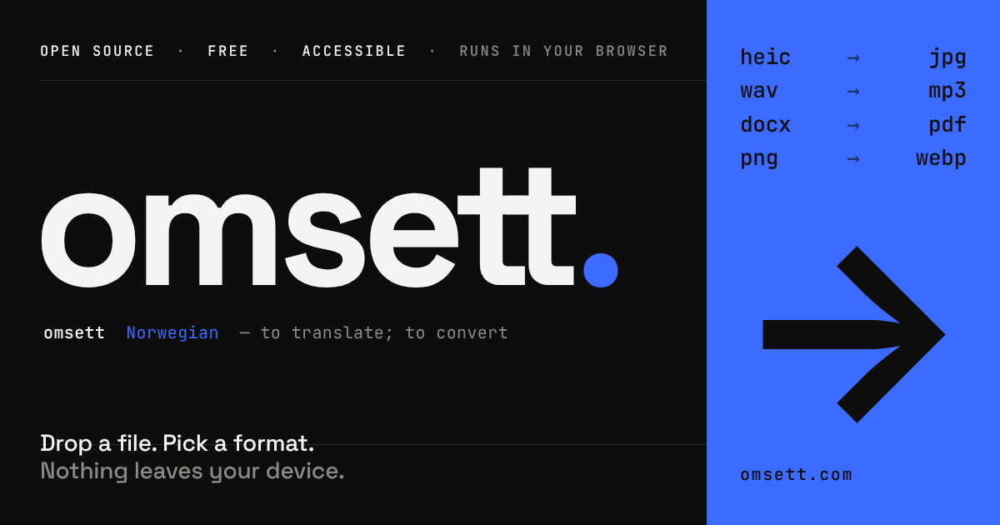

<p align="center">
  
</p>

# Omsett

**Drop a file. Pick a format. Nothing leaves your device.**

Omsett is a free, open-source, accessible file converter. Every conversion that can run in the browser runs there — images, audio, documents, data, archives, fonts, subtitles, and common video — so your files never touch a server. A desktop app adds the long tail (full ffmpeg, LibreOffice-grade office fidelity, Calibre ebook targets) on your own machine.

*Omsett* is Norwegian: to translate; to convert.

> **Status: pre-alpha.** Phase 0 is built: one real conversion, PNG → WebP, running entirely in the browser, with the plumbing every later format will use. Watch or star to follow along.

## What it will do

| Public site (omsett.com) | Desktop app | CLI |
| --- | --- | --- |
| Everything the browser can do: ~200 formats via WebAssembly and WebCodecs | The full suite, including video and office fidelity, with no server | `npx omsett report.docx --to pdf` — same engines in Node |
| Purpose presets: OpenGraph image, favicon pack, responsive set, Kindle | Watch folders, file associations, bundled ffmpeg | Batch, globs, `--watch`, JSON output for scripts |
| Fidelity warnings before you convert; metadata shown and stripped by default | Auto-update via GitHub Releases | Optional `omsett.config.ts` for build-time conversion |

A self-hostable `omsettd` (Docker) is planned for teams and phones that want the full suite through the browser on their own network. There is no public server; there never will be.

## Principles

- **Private by construction.** Browser-tier conversions make no network request with file data. Verifiable in DevTools.
- **Accessible as a feature.** WCAG 2.2 AA in the interface; tagged, structured PDF output by default.
- **Honest about limits.** Every target says where it runs and what it will lose before you click Convert.
- **The registry is data.** Adding a format is a record and a fixture, never a UI change.

## Stack

Nuxt 4 + Nuxt UI (static, on Netlify) · TypeScript · pnpm · Web Workers + WASM (`wasm-vips`, `pandoc-wasm`, `ffmpeg.wasm`, `mediabunny`) · Electron for the desktop app · Docker Compose for self-hosting.

## Run it locally

```
pnpm install
pnpm dev
open http://localhost:3000
```

Node 24 and pnpm (the versions in `.nvmrc` and `package.json`). `pnpm test` runs the unit and fixture tests; `pnpm build && pnpm e2e` runs the browser tests against the built site in Chromium, Firefox, and WebKit.

## Add a format

Formats are data. Nothing in the UI changes when one is added.

1. Add a `Format` record in [`packages/registry/src/formats/`](packages/registry/src/formats/) and list it in `formats/index.ts`. Write its `explain` paragraph for someone who has never heard of the format.
2. Add its id to the `reads` or `writes` of an engine in [`packages/registry/src/capabilities.ts`](packages/registry/src/capabilities.ts). Routes and fidelity warnings are derived from that.
3. Drop one small real file in `fixtures/<format-id>/`. The fixture tests pick it up and run it through every engine that claims the format.

A new engine also needs an implementation in [`packages/engines/src/`](packages/engines/src/) and an entry, with its license and source, in `info.ts` and [`THIRD-PARTY-NOTICES.md`](THIRD-PARTY-NOTICES.md).

## Deploy

**Netlify.** [`netlify.toml`](netlify.toml) holds the build command and publish directory; response headers and the Content-Security-Policy are generated by the build. Pull requests target the `staging` branch, which Netlify serves as a free branch deploy. `staging` is merged into `main` only for a release, because each production build is billed.

**Self-host.** `docker compose up --build` serves the same static build from Caddy at `http://localhost:8080`, as a non-root user on a read-only filesystem. To reach it from other devices, set `OMSETT_SITE_ADDRESS` to a hostname so Caddy serves HTTPS: away from `localhost`, browsers give multi-threaded WebAssembly and offline use to HTTPS only.

## Documents

- [`docs/00-high-level-design.md`](docs/00-high-level-design.md) — architecture, format matrix, engines, roadmap, brand
- `docs/01-kickoff-prompt-phase-0.md` — the Phase 0 build prompt for Claude Code
- [`AGENTS.md`](AGENTS.md) — the architecture rules and working agreements, condensed
- [`THIRD-PARTY-NOTICES.md`](THIRD-PARTY-NOTICES.md) — every shipped engine and library, with license and source
- [`brand/`](brand/) — OpenGraph image and its source

## Roadmap

| Phase | Gate |
| --- | --- |
| 0 · Foundation | PNG → WebP end to end on omsett.com |
| 1 · Images, data, archives, fonts, PWA | Squish parity; axe clean; NVDA pass |
| 2 · Documents, audio, ebooks, subtitles | DOCX → Markdown/EPUB and WAV → MP3 in the browser |
| 3 · Desktop app and CLI | DOC → tagged PDF locally; installers on 3 OSes |
| 4 · Video | 10-minute MOV → MP4 with progress, offline |
| 5 · Plugins | CAD, 3D, geospatial, HWP as registry plugins |

## Related

[vert.sh](https://github.com/VERT-sh/VERT) and [Filee](https://github.com/KnifeLemon/Filee) are the two projects Omsett learns most from; see the design doc for exactly what is borrowed and credited.

## License

[MIT](LICENSE) © 2026 Christopher Schweda
